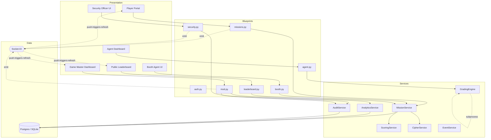
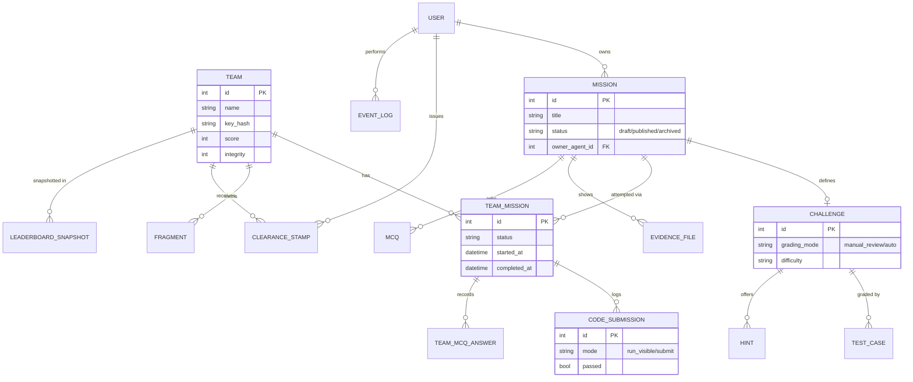
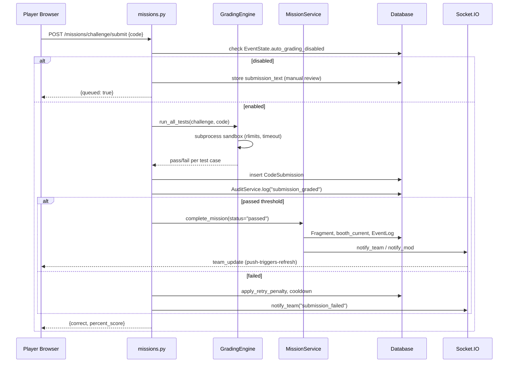
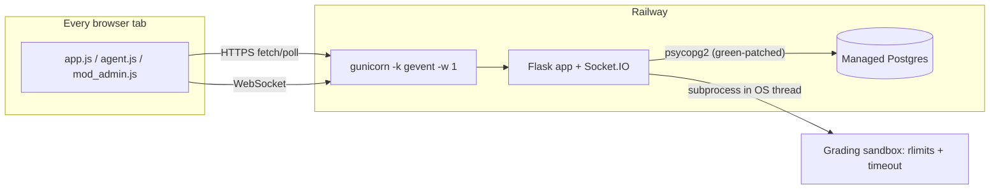

# DevCrypt — System Design Summary

This document explains DevCrypt's architecture the way a system-design interview or an
engineering design review would: not just *what* was built, but *why*, and what the
alternatives and trade-offs were at each decision point. Where something described here is
aspirational rather than implemented today, that is called out explicitly — a design summary
that quietly overstates what exists is worse than useless once you rely on it.

---

## 1. Project Overview

**What it does.** DevCrypt is a hybrid digital-physical Capture-the-Flag platform for career
fairs and hackathons. Teams of 4–6 register once, then physically move between employer
booths — each booth is a "compromised node" in a fictional incident-response narrative.
At each node a team reviews forensic evidence (logs, source code, network traces), answers
threat-assessment questions, and completes an engineering challenge. Completing a node
awards an encrypted cipher fragment and reveals letters on a shared cryptogram board. After
all nodes are cleared, the team submits a final flag to "restore" the system. (An earlier
revision also required two Security Officer clearance stamps before the final submission;
that gate was removed — see below.)

**Primary goals**, in priority order:

1. **Assess real skill under time pressure** — not multiple-choice trivia, but log analysis,
   debugging, SQL, and secure-coding tasks reviewed by an actual engineer at the booth.
2. **Give employers a structured reason to engage**, not a passive table — each booth becomes
   a checkpoint the employer's own staff run.
3. **Give organizers live visibility with zero manual tracking** — no paper scoring, no
   spreadsheets during the event.
4. **Never eliminate a team** — a soft-lock system (timers, hints, override) keeps everyone
   playing until the end, which matters for a 4–6 hour event where early elimination means a
   student just leaves.

The system is deliberately **not** trying to be a general CTF platform (like CTFd) — it is
narrow and opinionated around this one physical-plus-digital event format.

---

## 2. Functional Requirements

**Core features**

- Team authentication via a shared team key (not per-player accounts).
- Staff authentication via email/password with three distinct roles.
- A sequenced mission structure per node: evidence review → 3 threat-assessment MCQs → one
  engineering challenge (code / MCQ / flag, depending on the node).
- A live cryptogram board that reveals one letter per correct MCQ answer, in real time.
- Fragment generation on mission completion, derived server-side (teams can never see or
  guess another team's fragment).
- A soft-lock system: incorrect submissions never block progress permanently — they cost
  time (penalty timer), points (hint), or heavy points + an audit-logged override.
- Security checkpoints: clearance stamps, issued by a human Security Officer, are audit-only —
  they log a checkpoint visit and award a small score bonus, but do not gate mission progress.
  (Originally designed as a hard gate on the final mission; removed once fragment possession
  was recognized as already-sufficient, server-verified proof of completion — the gate had no
  precondition of its own and was fully bypassable via the Game Master's override, so it wasn't
  actually verifying anything.)
- A live, publicly visible leaderboard.
- Game Master controls: start/pause/end the event, broadcast a message to every team, force
  an override, export a CSV report.
- A standalone credential-generation script for real events (rotates every team key and
  staff password, optionally emits QR codes for printed key cards).

**User capabilities by role** are covered in detail in [Section 4](#4-actors).

---

## 3. Non-Functional Requirements

This is the section where "what we actually have" and "what we'd want at larger scale"
diverge the most, and it's worth being explicit about that gap rather than papering over it.

| Requirement | Target | Current reality & reasoning |
|---|---|---|
| **Scalability** | Handle a full event's concurrent team count (dozens to ~100 teams) without degrading. | The layered architecture (below) scales horizontally at the *application* tier trivially — Flask is stateless per request. The real constraint was a **correctness bug, not a capacity limit**: team login used to bcrypt-verify every team's key sequentially until it found a match. Measured at ~500–700ms per bcrypt check in this environment, that meant a login could take **up to ~68 seconds at 100 teams** — past a typical gunicorn worker timeout. This was fixed by looking the team up by its already-unique `name` column first (a cheap indexed comparison) and bcrypt-verifying only that one row. This is the kind of bug that's invisible at demo scale (2–5 teams) and only surfaces exactly at the scale you're asking about — a good illustration of why "scalability" isn't just "add more servers," it's auditing every O(n) operation against your expected n. |
| **Reliability** | No data loss on refresh, device switch, or a booth agent's tablet dying mid-review. | All game state lives in the database, not in browser storage or server memory — a team can reload or switch devices and their session (cookie) plus DB state reconstruct everything. The one thing that *is* client-side and ephemeral is an in-progress, unsubmitted textarea draft — a deliberate, acceptable trade-off (see `app.js`'s draft-preservation logic), since submitted state always persists immediately. |
| **Availability** | Stay up for the duration of a live event; a crash mid-event is much worse than a crash mid-development. | Two deployment modes exist for different availability needs: an offline single-laptop demo mode (no dependency on internet at all — if the venue Wi-Fi to the *outside world* drops, the event keeps running since players only need the local network), and a cloud mode (Railway + managed Postgres, currently live) for when the event needs to be reachable beyond one room. |
| **Security** | Protect team keys/staff passwords, prevent one team from affecting another, prevent client-side score tampering. | Covered in depth in [Section 11](#11-security-considerations). |
| **Maintainability** | A new engineer should find the right file within about a minute. | Enforced structurally, not by convention alone: routes call services, services call repositories, repositories touch the ORM — and nothing skips a layer. See [Section 5](#5-high-level-architecture). |
| **Performance** | Leaderboard and mission state should feel "live" (sub-2-second updates). | Met via 2-second polling intervals, not WebSockets — a deliberate trade-off explained in [Section 5](#5-high-level-architecture) and revisited in [Section 12](#12-future-improvements). |

---

## 4. Actors

| Actor | Real-world equivalent | Core action | Design constraint this drives |
|---|---|---|---|
| **Team** | Student/graduate participant | Read evidence, answer questions, submit a fix, decode the cryptogram, capture the flag | Must work with zero onboarding — no tutorial, no jargon. Also must never see another team's answer key or fragment. |
| **Booth Agent** | Employer engineer staffing one booth | Review a team's code submission and PASS / RETRY / HINT / OVERRIDE it | Must be usable by someone who has never seen the tool before, in under 30 seconds, with no technical setup. This is why the booth UI is deliberately a single queue with four big buttons and nothing else. |
| **Security Officer** | Event security / checkpoint staff | Issue clearance stamps at physical checkpoints | Needs a dead-simple "who's been stamped" grid — this role does not touch scoring or mission logic at all, which is why it's a separate role rather than folded into Booth Agent. |
| **Moderator (Game Master)** | Event organizer/admin | Start/pause/end the event, monitor every team, broadcast, override, export | Needs full situational awareness *and* emergency override power, because they are the only actor who can unstick a team if something goes wrong live. |

Two design decisions worth calling out here:

- **Teams are not "users."** A whole team shares one key; there is no per-player identity. This
  was a deliberate simplification — modeling every player as an individual authenticated
  account would add real complexity (who submits on behalf of the team? what if a player's
  phone dies?) for no gameplay benefit, since the unit of competition is the team, not the
  player.
- **Booth Agent and Security Officer are separate roles**, not one "staff" role with
  permissions flags, because their UIs and mental models are completely different (one
  reviews code, one stamps checkpoints) and conflating them would mean building a
  general-purpose permissions system for a two-role distinction that's simpler as two roles.

---

## 5. High-Level Architecture

DevCrypt follows a **strict layered architecture**: each layer may only call the layer
directly below it. This is the single architectural decision that most shapes how easy the
codebase is to extend, so it's worth explaining the reasoning, not just stating it.

```
┌─────────────────────────────────────────────────────────┐
│  Presentation                                            │
│  Jinja templates + vanilla JS, polling JSON endpoints      │
│  (Player / Booth / Security / Moderator / public portals) │
└───────────────────────────┬─────────────────────────────┘
                             │ HTTP (fetch/forms)
┌───────────────────────────▼─────────────────────────────┐
│  Application (Flask Blueprints)                           │
│  auth · missions · cipher · scoring · leaderboard ·        │
│  booth · security · mod · portals                          │
│  — owns routing, request parsing, response shaping         │
└───────────────────────────┬─────────────────────────────┘
                             │ plain function calls
┌───────────────────────────▼─────────────────────────────┐
│  Service (business logic)                                  │
│  MissionService · ScoringService · CipherService ·          │
│  EventService · AuditService                                │
│  — the soft-lock rules, scoring formulas, cipher/HMAC       │
│    fragment generation all live here, and only here         │
└───────────────────────────┬─────────────────────────────┘
                             │ plain function calls
┌───────────────────────────▼─────────────────────────────┐
│  Repository                                                 │
│  TeamRepository, and direct SQLAlchemy queries for models   │
│  without a dedicated repository yet                         │
│  — the only layer allowed to touch the ORM                  │
└───────────────────────────┬─────────────────────────────┘
                             │ SQLAlchemy
┌───────────────────────────▼─────────────────────────────┐
│  Database — SQLite (offline demo) / PostgreSQL (production) │
│  identical schema; only the connection string changes       │
└─────────────────────────────────────────────────────────┘
```

**Why this matters in practice**: when the booth-agent PASS/RETRY/HINT/OVERRIDE actions
needed identical soft-lock rules as the auto-validated MCQ/flag paths, that logic already
lived in one place (`MissionService.complete_mission`) — the two entry points (a route
calling it after a booth agent click, versus a route calling it after an auto-validated
answer) just call the same function. If scoring rules had been duplicated inline in each
route instead, that consistency would have had to be maintained by hand across every call
site, and it would have been trivial for one path to silently drift from another (which
is exactly the kind of bug that shows up as "why did this team get points for hint usage
they shouldn't have").

**Where Socket.IO and QR fit in**:

- **Socket.IO push is active**, layered on top of the polling described above rather than
  replacing it — the guiding principle is **push-triggers-refresh, not push-carries-state**.
  Every emit (`app/sockets.py`) is a bare `{"type": "..."}` ping with no game-state payload; the
  browser reacts by calling the exact same `refresh()` function its poll loop already calls.
  This means there is still only one rendering/serialization path (the REST endpoints) to keep
  correct, and a socket payload can never leak anything those endpoints already filter (hidden
  test cases, `solution_code`, another team's fragment). A dropped or never-connected socket
  degrades to precisely the 2-second poll guarantee the original NFR-05 design already promised
  — the fallback isn't hypothetical, it's the literal mechanism this shipped with first. This
  needed an async-capable gunicorn worker (`-k gevent`, see §10) — sync workers only support
  Socket.IO's long-polling fallback, never a true WebSocket upgrade — plus green-patching
  `psycopg2` (blocking libpq calls would otherwise stall every open socket for their duration).
  The grading subprocess call (`app/services/grading_service.py`) uses a plain, direct
  `subprocess.run()` — an earlier attempt to route it through
  `gevent.get_hub().threadpool` to sidestep a suspected fork/greenlet interaction was tried and
  reverted, because it broke every auto-graded submission in production
  (`RuntimeError: child watchers are only available on the default loop`). gevent's own
  monkey-patched `subprocess` module already replaces `Popen` with a cooperative version
  designed to be called directly from the hub thread — dispatching it into a worker thread
  instead breaks its child-watcher setup. The code comment in `grading_service.py` documents
  this explicitly so it doesn't get "fixed" back into a thread pool by someone who reads the
  general gevent/fork advice without knowing this was already tried here.
- **QR codes remain a credential-delivery mechanism, not an authentication method.**
  `generate_credentials.py --qr` encodes a team's plaintext key (and a login URL) as a QR image
  meant to be printed onto a physical key card and typed in by hand or copy-pasted after
  scanning — the application itself never reads a QR code. This is unchanged from the original
  design; see [Section 12](#12-future-improvements) for what a genuine scan-to-login flow would
  need.

---

## 6. Component Breakdown

| Component | Responsibility |
|---|---|
| `app/__init__.py` | Application factory — wires extensions, registers blueprints, registers the `icon()` Jinja helper, creates tables on boot. |
| `app/config.py` | Environment-driven configuration: `SECRET_KEY`, `DATABASE_URL` (normalized for scheme differences between providers), `EVENT_SALT`. |
| `app/extensions.py` | Singleton instances: `db` (SQLAlchemy), `migrate` (Alembic), `socketio`, `bcrypt`, `login_manager`. |
| `app/decorators.py` | `team_required` (session-flag gate for player routes), `roles_required(*roles)` (Flask-Login role gate for staff routes), `current_team()` helper. |
| **Blueprints** (`app/blueprints/`) | |
| &nbsp;&nbsp;`auth.py` | Team-key login, staff email/password login, unified logout. |
| &nbsp;&nbsp;`missions.py` | The player-facing mission loop: status polling, MCQ answers, challenge submission, hint requests. |
| &nbsp;&nbsp;`cipher.py` | Read-only cryptogram board state. |
| &nbsp;&nbsp;`scoring.py` | Per-team score breakdown. |
| &nbsp;&nbsp;`leaderboard.py` | Public, unauthenticated live leaderboard. |
| &nbsp;&nbsp;`booth.py` | Booth Agent's submission queue and PASS/RETRY/HINT/OVERRIDE actions. |
| &nbsp;&nbsp;`security.py` | Security Officer's checkpoint stamping. |
| &nbsp;&nbsp;`mod.py` | Game Master's event controls, team monitoring, broadcast, override, CSV export. |
| &nbsp;&nbsp;`portals.py` | Presentation-only entry points (`/team`, `/staff`, `/moderator`) — no auth logic of its own, just branded fronts for the shared login forms. |
| **Services** (`app/services/`) | |
| &nbsp;&nbsp;`mission_service.py` | Mission sequencing, idempotent completion (`complete_mission` guards against double-processing an already-resolved mission), soft-lock state transitions. |
| &nbsp;&nbsp;`scoring_service.py` | The point/integrity formulas — the single source of truth for "how many points is this action worth." |
| &nbsp;&nbsp;`cipher_service.py` | Deterministic per-mission Caesar shift, cryptogram board rendering, HMAC-SHA256 fragment generation. |
| &nbsp;&nbsp;`event_service.py` | Event lifecycle (`not_started` / `running` / `paused` / `ended`), broadcast message storage. |
| &nbsp;&nbsp;`audit_service.py` | Immutable event-log writes for every consequential staff action. |
| **Repositories** (`app/repositories/`) | `TeamRepository` — team creation and lookup, the only place team-key verification logic lives. |
| `app/icons.py` | Server-side inline SVG icon rendering (Jinja global), sourced from Lucide's ISC-licensed static icon set — no icon-font or JS-library dependency. |
| `app/static/app.js` | All client-side polling, rendering, and form-submission logic for the player, booth, moderator, and leaderboard pages; also carries a client-side mirror of the icon set for JS-rendered content. |
| `generate_credentials.py` | Standalone admin script (not a web route) — rotates team keys and staff passwords for a real event, optionally emitting QR key cards. |

---

## 7. Data Flow

### A team logs in

```
Browser (POST name+key to /auth/team-login)
  → auth.team_login()
    → TeamRepository.get_team_by_name(name)      [fast: indexed unique column]
    → team.check_key(key)                        [bcrypt verify, exactly once]
    → session["team_id"] = team.id               [plain Flask session cookie]
  → redirect to /missions/play
```

No Flask-Login involved here at all — teams use a much simpler mechanism than staff, by
design (see [Section 4](#4-actors) on why teams aren't modeled as individual users).

### A mission (engineering challenge) is submitted

```
Browser (POST /missions/challenge/submit, JSON {answer})
  → missions.submit_challenge()
    → team_required gate, current_team()
    → MissionService: check event is running, mission not locked, not on cooldown
    → dispatch by challenge.type:
        "code"       → store submission_text, mark pending review, return "queued"
        "mcq"/"flag" → compare answer to challenge.answer_key server-side
    → on pass: ScoringService awards points/integrity, CipherService.generate_fragment()
    → db.session.commit()
  → JSON response → client shows narrative feedback, next poll picks up new state
```

### A coding challenge is graded

This is the one place where "graded" means two different things depending on type, and
that's a deliberate PRD decision, not an inconsistency:

- **`code` type** is never auto-graded — it always routes to a Booth Agent's queue. Automatic
  grading of free-form code would need a sandboxed execution environment, which is real
  infrastructure the demo/MVP intentionally deferred in favor of the human-in-the-loop
  interaction that makes the format valuable to employers in the first place (see
  [Section 1](#1-project-overview), goal #2).
- **`mcq` and `flag` types** are auto-validated server-side by exact string match against
  `Challenge.answer_key` — no client ever receives the answer key, so this can't be
  reverse-engineered from the page source.

### A booth agent validates an answer

```
Browser polls GET /booth/queue/data every 2s
  → booth.queue_data() returns pending submissions for this agent's assigned mission
Agent clicks PASS / RETRY / HINT / OVERRIDE
  → POST /booth/submission/<team_mission_id>/<action>
    → roles_required("booth_agent") gate
    → MissionService applies the matching outcome:
        PASS     → complete_mission(status="passed") → fragment generated
        RETRY    → penalty_until set, attempts incremented
        HINT     → integrity penalty, hint_text released, hints_used incremented
        OVERRIDE → complete_mission(status="overridden"), heavy penalty, AuditService.log()
    → db.session.commit()
  → team's next poll (≤2s later) reflects the new state
```

### A moderator broadcasts an announcement

```
Moderator submits broadcast form → POST /mod/broadcast
  → mod.broadcast()
    → EventState.broadcast_message = message, broadcast_at = now()
    → db.session.commit()
Every connected page's next poll cycle (player, booth, leaderboard — all ≤2s)
  → sees broadcast in the /missions/status (or equivalent) payload
  → renders the banner client-side
```

Note there is no push here — the moderator's action changes a row, and every client's own
polling loop is what surfaces it. This is the direct, visible cost of the polling-over-
WebSockets trade-off from Section 5: an announcement can take up to ~2 seconds to appear on
a given screen, never faster, because nothing proactively wakes the client up.

---

## 8. Database Design Summary

Fourteen tables, in four rough groups:

**Identity & access**
- `users` — staff accounts (`role`: booth_agent / security_officer / game_master), bcrypt password hash.
- `teams` — one row per team, bcrypt key hash, running `score`/`integrity`.
- `team_players` — many-to-many between teams and (optional) individual player accounts.

**Mission content** (authored once, not per-team)
- `missions` — one per node, includes `cipher_word` and `order_index`.
- `evidence_files` — log/code/network-trace content shown per mission.
- `mcqs` / `mcq_options` — threat-assessment questions; `is_correct` and `cipher_letter_index` never sent to the client.
- `challenges` — the engineering-challenge definition per mission (`type`, `prompt`, `answer_key`, `hint_text`).

**Per-team progress** (the actual game state)
- `team_missions` — status machine per team per mission (`not_started` → `in_progress` → `passed`/`overridden`), attempts, penalty timers, hint usage.
- `team_mcq_answers` — every answer, correct or not, for analytics/audit.
- `fragments` — one HMAC-derived value per team per completed mission.
- `clearance_stamps` — issued by Security Officers; audit trail + score bonus only, does not
  gate mission progress.

**Operational / analytics**
- `leaderboard_snapshots` — periodic point-in-time captures for post-event analysis (the live leaderboard itself is computed on demand, not read from here).
- `event_logs` — immutable audit trail of every consequential staff action (pass/retry/hint/override/broadcast/event-state-change), each with actor identity and timestamp.
- `event_state` — a singleton row holding the whole event's lifecycle status and the current broadcast message.

**Key relationships**: a `Team` has many `TeamMission`s (one per `Mission`), which in turn own
that team's `TeamMCQAnswer`s. `Fragment` and `ClearanceStamp` both belong to a `Team`. Nothing
in this schema is per-player — every progress-tracking row keys off `team_id`, reinforcing the
"team is the unit of play" decision from Section 4.

---

## 9. Technology Choices

Each of these was a real choice among alternatives, not a default — worth walking through
what else was considered and why it lost.

- **Flask** over Django or FastAPI. Django's batteries (admin, ORM, auth) are heavier than
  this project needs and its conventions fight a from-scratch domain model; FastAPI's async
  and auto-generated OpenAPI docs are genuinely nice but buy nothing for a server-rendered
  app with no external API consumers. Flask's Blueprint system was sufficient to enforce the
  layered architecture in Section 5 without a framework opinion getting in the way.
- **SQLAlchemy** as the ORM, specifically to keep raw SQL out of the application entirely.
  This matters more than it sounds: every query goes through the ORM's parameterization, so
  SQL injection isn't a category of bug that can occur here by accident, and the same model
  definitions work unmodified against both SQLite (demo) and Postgres (production) — the
  schema migration from one to the other is a connection-string change, nothing else.
- **Flask-Login** for staff sessions specifically (not for teams — see Section 4). It gives
  battle-tested session handling, `current_user`, and role-gate-friendly hooks for free,
  rather than hand-rolling cookie/session logic for the one actor group that actually needs
  individual accountability (booth agents, security officers, the game master — every
  override they perform is logged against their identity).
- **Flask-SocketIO**, now actively handling real-time push (Section 5) via an async gunicorn
  worker, not just present-but-dormant in the dependency graph.
- **PostgreSQL** for production, **SQLite** for the offline demo — not a compromise, a
  genuine two-mode design. SQLite needs zero setup (no server, no credentials, no network),
  which is the whole point of a "one laptop, ten minutes to running" demo target. Postgres
  handles genuine concurrent writes safely, which SQLite's single-writer lock does not, and
  is required the moment more than one process might write at the same time.
- **Railway** (current live deployment) for zero-ops HTTPS hosting with automatic deploys on
  push to `main`, paired with a managed Postgres add-on. Chosen over Vercel's serverless model
  specifically because Socket.IO needs a genuine long-lived process holding a WebSocket
  connection open — a fit serverless functions don't have.

---

## 10. Deployment Architecture

Two deployment shapes exist because they serve two genuinely different events, not because
one is "the real one" and the other is a toy:

**Local single-laptop demo** — `python3 run.py` (not `flask run`, which never executes the
`socketio.run()` call and would silently serve a dev server that can't hold a WebSocket
upgrade open), SQLite file in the project directory, every role's browser connects over the
venue's local Wi-Fi. No external network call is required for the game to function (per
NFR-05). This is the right shape for a small event, a dry run, or anywhere internet access at
the venue is unreliable.

**Cloud deployment** (Railway + managed Postgres, currently live) — appropriate once the event
needs to be reachable from anywhere, needs to survive a single laptop dying, or needs multiple
simultaneous booths/rooms that shouldn't all depend on one machine's Wi-Fi radio. Production
command:

```
gunicorn -k gevent -w 1 -b 0.0.0.0:$PORT --timeout 60 --graceful-timeout 60 "app:create_app()"
```

**Single gevent worker, not multiple sync workers with threads.** Flask-SocketIO needs an
async-capable worker to hold true WebSocket connections open at all (sync workers only support
Socket.IO's HTTP long-polling fallback), and `socketio.emit()` only reaches clients on the
*same* worker process unless a shared message queue (Redis) fans it out across workers. Since
this deploys as a single instance for one event, `-w 1` sidesteps the cross-worker broadcast
problem entirely rather than adding Redis as new infrastructure to provision and misconfigure
before the event — a deliberate trade-off, not an oversight. **The cost is explicit**: no
worker-level failover — a crashed worker is a total outage until gunicorn's arbiter (a separate,
always-alive parent process) respawns it, versus the old multi-worker model where one stuck
worker only cost a fraction of capacity. This is mitigated, not eliminated, by the
push-triggers-refresh design (Section 5): a worker restart just means a brief gap where clients
fall back to their still-running poll loop until reconnect.

One gevent process handles the event's realistic concurrency fine once two correctness risks
are handled, not just worker count:

1. `gevent.monkey.patch_all()` does not patch `psycopg2` by default. Since nearly every request
   touches Postgres, an unpatched blocking libpq call would stall *every* open WebSocket and
   in-flight request for the query's duration the first time two requests overlapped — fixed by
   `psycogreen.gevent.patch_psycopg()` at boot (`app/__init__.py`).
2. The grading subprocess call (`app/services/grading_service.py`) forks a child process to run
   submitted code. The intuitive fix for "forking from inside a gevent greenthread" is to route
   it through a real OS thread pool (`gevent.get_hub().threadpool.apply(...)`) — this was tried
   and reverted, because it broke every auto-graded submission in production. gevent's
   monkey-patching replaces `subprocess.Popen` with a cooperative version whose child-watcher
   setup only works when called from the hub thread itself; dispatching it into a worker thread
   crashes with `child watchers are only available on the default loop`. The actual, correct fix
   is simpler than the intuitive one: call `subprocess.run()` directly. gevent's patched
   `subprocess` module already makes `Popen.wait()` cooperative (it yields to other greenlets —
   other requests, open WebSockets — while the child runs), so no thread pool is needed at all.

---

## 11. Security Considerations

- **Authentication**: teams via a shared bcrypt-hashed key (Section 7); staff via
  bcrypt-hashed password + Flask-Login session. Plaintext keys/passwords are never persisted
  — only shown once, at generation time, in `generate_credentials.py`'s output file (which is
  gitignored and meant to be deleted after printing key cards).
- **Authorization**: enforced at the route level via `@team_required` (session flag present)
  and `@roles_required(*roles)` (Flask-Login role check), never left to the frontend to
  enforce or hide. A player hitting `/mod/*` directly gets a 403 regardless of URL knowledge.
- **Session management**: Flask's signed session cookie, keyed by `SECRET_KEY`. This is why
  `SECRET_KEY` must be a fixed, real secret in production and not the hardcoded development
  default — if it changes between requests (e.g., because multiple server instances each
  generated their own random default), every existing session/login breaks unpredictably.
- **QR authentication**: as described in Section 5, this is not currently an authentication
  mechanism — QR codes are a printing convenience for delivering a team's plaintext key onto
  a physical card. If a genuine scan-to-login flow were added, the key trade-off to design
  around is **replay risk**: a QR code containing the literal team key is exactly as sensitive
  as the key itself and needs the same handling (never logged, never sent over plain HTTP,
  rotated per event) — encoding a short-lived signed token instead of the raw key would be the
  safer evolution, at the cost of needing a token-issuance step before the code can be printed.
- **Hashing**: bcrypt for anything a human chose or was assigned (team keys, staff passwords)
  — deliberately slow, which is correct for credentials but was also the exact mechanism
  behind the scaling bug in Section 3, a good example of a security-correct choice having a
  performance trade-off that has to be designed around rather than avoided (you do not want a
  *faster* hash for credentials just to fix a lookup-pattern bug). HMAC-SHA256 for fragment
  values, which are not credentials but do need to be unpredictable and non-forgeable by a
  team — a fast hash is fine and appropriate here since fragments aren't secrets being
  brute-forced offline, they just need to resist guessing without the server-side salt.
- **Environment variables**: `SECRET_KEY`, `DATABASE_URL`, `EVENT_SALT` are read via
  `os.getenv()` with safe local-dev defaults, but are required to be set as real secrets in
  any hosting platform's environment variable settings — never committed to the repository.
- **HTTPS**: terminated by the hosting platform (Railway's own TLS) — the
  application itself doesn't handle certificates, which is the correct division of
  responsibility for a small team without dedicated infrastructure staff.
- **Role-based access control**: three staff roles plus the team "role," each gated to
  exactly the routes it needs, with every consequential staff action (pass/retry/hint/
  override/broadcast/event-state-change) written to the immutable `event_logs` table with
  actor identity — so a disputed outcome during a live event can always be audited after
  the fact.

---

## 12. Future Improvements

The layered architecture in Section 5 was specifically chosen so that each of these can be
added by extending one layer, without the core game engine (the service layer's mission
sequencing, scoring, and cipher logic) needing to change at all:

- ~~Real-time push via Flask-SocketIO~~ — **done**, see Section 5/6.
- ~~A custom mission builder~~ — **done**, see Section 13 (Agent Dashboard).
- ~~An employer/organizer analytics dashboard~~ — **done**, see Section 14.
- **Genuine QR-scan-to-login**, issuing short-lived signed tokens instead of raw team keys,
  layered on top of the existing `auth.team_login` logic rather than replacing it. Still not
  built — QR remains a printing convenience (Section 5).
- **Adaptive difficulty** — struggling teams get simpler evidence sets — would live entirely
  inside `MissionService`, since mission selection is already centralized there. Note this is
  distinct from `Challenge.difficulty` (Section 13/14), which is an agent-declared display
  label today, not a selection input.
- **Multi-event / multi-tenant support** — every table would need an `event_id` foreign key,
  but the layered separation means the scoring/cipher logic doesn't know or care which event
  it's running for today, so this is a repository/model change, not a service-layer rewrite.
- **AI-generated post-event feedback** — a new read-only service consuming `team_mcq_answers`
  and `event_logs`, with no changes to how the game itself runs.
- **An event-wide countdown timer** — `Mission.time_limit` exists per-booth (Section 3), but a
  timer for the whole event is a different, larger feature needing a background scheduled
  check, deliberately deferred rather than built during the Section 14 pass.
- **Multi-language grading, container/namespace sandboxing** — the grading engine (Section 13)
  is Python-only and uses OS-level rlimits, not container isolation; both are real limitations
  worth addressing before scaling to an adversarial or larger-language-surface event.
- **Achievement badges** — additive: new table, no changes to the existing mission loop.

The common thread: none of these require touching `MissionService`, `ScoringService`, or
`CipherService` — which is the payoff of having enforced the layer boundaries from day one
rather than letting business logic leak into routes where each new feature would have to
rediscover the existing rules instead of reusing them.

---

## 13. Agent-Managed Challenge Platform

Section 7 flagged automatic code grading as a deliberate deferral: it needed sandboxed
execution infrastructure the MVP didn't have yet, so `code`-type challenges always routed
to a human Booth Agent instead. This section is that deferred work, plus turning challenge
*authorship* over to each stakeholder's own Agent instead of it being hardcoded in `seed.py`
— item 7 in Section 12's own future-improvements list ("a custom mission builder").

**The single fork point.** A new `Challenge.grading_mode` column (`"manual_review"` default,
or `"auto"`) is the one thing every new code path checks. Existing rows — every seeded
mission — default to `"manual_review"` and are byte-for-byte unaffected: same booth queue,
same PASS/RETRY/HINT/OVERRIDE buttons, same scoring. `"auto"` is only ever set by an Agent
explicitly saving a challenge through the new Agent Dashboard.

**New service: `GradingEngine`** (`app/services/grading_service.py`), parallel to
`ScoringService`/`CipherService` in the layered architecture. It takes a `Challenge` and a
submitted code string and returns pass/fail per test case — it never touches the ORM or
knows about HTTP. Isolation is OS-level subprocess confinement: a fresh temp dir per run,
`subprocess.run()` with a hard wall-clock timeout, and a `preexec_fn` setting `RLIMIT_CPU`/
`RLIMIT_AS`/`RLIMIT_NPROC` before exec. This is **not** container/namespace isolation —
appropriate for a supervised booth setting where teams are physically present, not for
hosting adversarial untrusted code at internet scale. Source-scanning/blocklisting was
deliberately not used as a security control, since it's trivially bypassable and would be a
false sense of safety; the rlimits/timeout are the actual boundary.

**New models** (all additive — see the migration in `migrations/versions/`): `TestCase`
(input/expected-output/weight/visibility per challenge), `Hint` (multiple configurable
hints, additive alongside the legacy single `Challenge.hint_text`), `CodeSubmission` (one
row per Run/Submit click, feeding the Game Master's live submissions monitor), `TeamMember`
(a lightweight roster row — name/email, no password, no session — added without reopening
Section 4's "teams are not users" decision). `Mission.owner_agent_id` binds a booth to
exactly one Agent; `Team.starting_mission_id` lets the Game Master rotate a team's starting
booth while keeping the highest-`order_index` mission (the final vault) always last,
regardless of rotation.

**New blueprint: `agent.py`**, separate from `booth.py`. `booth.py` is unchanged — it's
still the live-event review queue. `agent.py` is the pre-event content-authoring surface:
CRUD on a mission's `Challenge`/`TestCase`/`Hint`/supporting files, scoped so an Agent can
only ever touch a `Mission` where `owner_agent_id` matches their own user id (a 404, not a
403, on someone else's booth — an Agent shouldn't be able to tell another stakeholder's
booth exists). `Challenge.solution_code` is server-side-only and never appears in any
player-facing serializer.

**Player-facing changes are additive to `missions.py`.** `_serialize_challenge()` only adds
`starter_code`/`language`/`function_signature` when `grading_mode == "auto"`. A new
`POST /missions/challenge/run-tests` route runs only `TestCase.visibility == "visible"` rows
— hidden tests are never fetched, let alone serialized, on that path. `submit_challenge()`
gained one new branch at the top, gated on `grading_mode == "auto"`; the existing
`manual_review` branch below it is untouched. Both branches still end by calling
`MissionService.complete_mission()`, which gained an optional `grading_result` parameter —
when present it calls the new `ScoringService.score_auto_graded_pass()` (weighted-percent
scoring against `Challenge.pass_threshold`, plus the challenge's configured `bonus_points`)
instead of the flat `score_mission_pass()`. Fragment generation, `booth_current`
advancement, and audit logging are the same code path either way.

**Game Master additions extend `mod.py`**, not fork it: team/member CRUD, credential + QR
generation (wrapping the key-generation logic already in `generate_credentials.py`, now
factored into `app/services/credential_service.py` so both the CLI script and the web routes
import the same functions instead of duplicating them), an Agents & Booths overview, a live
`CodeSubmission` feed, an explicit score-override route (distinct from the existing
pass/overridden status override), and `EventState.status` gaining two new values — `draft`
(brand-new installs only; existing deployments' EventState row is untouched) and `archived`
— read by every existing `status != "running"` check with no new branches needed. The Game
Master deliberately has no route that writes to `Challenge` fields; that boundary is
enforced by omission, not a runtime check that could be forgotten later.

---

## 14. Phase 2 — Operational Hardening & Moderator Tooling

This pass focused on usability, configurability, and moderator experience for a production
event, explicitly *not* new architecture — see `SYSTEM.md` §6a/§7a/§8b for what each surface
does; this section is about the design decisions behind them.

**Security Officer: from gate to audit trail.** The original design blocked the final
mission's submission unless a team held two `ClearanceStamp`s. That gate was removed, not
softened, because auditing it surfaced it wasn't actually verifying anything: `issue_stamp`
had no precondition (any officer could stamp any team at any time), and the Game Master's
override route already bypassed it entirely. A gate with a standing bypass and no precondition
isn't a weaker gate, it's a placebo. `ClearanceStamp` is kept as an audit trail with a small
score bonus — genuinely useful for a physical-checkpoint event format — but reframed
honestly as what it verifies (a checkpoint visit happened) rather than what it doesn't (that a
team's work is legitimate; the fragment already proves that).

**Draft state, not a bolt-on flag.** `Mission.status` could have been a boolean
`is_published`. A three-state (`draft`/`published`/`archived`) field was chosen instead because
"hide this from players" and "I'm done with this and don't want it cluttering my active list"
are different intents an Agent actually has, and collapsing them into one boolean would have
forced archived content back into the draft list with no way to distinguish "still being
written" from "retired."

**Rejecting two of the literally-requested Event Setup fields.** "Number of booths" as an
editable number was rejected in favor of a read-only count derived from `Mission.query` —
a config field that must be kept in sync with the actual mission set by hand is exactly the
failure mode that produced the hardcoded `>= 6` bugs this same pass fixed elsewhere (the
"finished" threshold, independently duplicated in two blueprints, plus `/6` and `/2`
denominators duplicated again in two frontend templates). "QR login enabled" was rejected
outright: QR codes were never a distinct authentication path (Section 5) — encoding the same
plaintext key used for manual entry — so there is no real toggle to build without fabricating
one that does nothing.

**`auto_grading_disabled` as a genuine kill switch, not a wizard cosmetic.** When set, it
doesn't just hide a UI element — `submit_challenge` and `run_visible_tests` both stop invoking
`GradingEngine` before it runs, and submissions fall through to the pre-existing manual-review
queue. This reuses `booth.py`'s existing human-review path instead of inventing a second one,
and exists specifically as an event-day recovery tool alongside the Emergency Mode actions
(`SYSTEM.md` §6a) — the shared design goal across all of them is "the Game Master can always
get a stuck team unstuck without a code deploy."

**Reusing existing signals instead of adding infrastructure.** `LeaderboardSnapshot` existed in
the original schema but nothing ever wrote to it. Rather than add a scheduler/cron dependency
to populate it, the write is hooked into the three call sites that already fire
`notify_global("leaderboard_refresh")` — an existing "something scoreable changed" signal,
reused rather than duplicated. Analytics visualizations reuse the existing `.timer-bar` CSS
progress-bar primitive instead of adding a charting library; the Moderator Activity Feed reuses
the existing `EventLog`/`AuditService` audit trail instead of building a parallel logging
system. The common thread across this whole pass: extend what's there before reaching for a
new dependency.

### Component diagram



### Entity-relationship diagram (core gameplay tables)



### Sequence diagram — auto-graded submission, end to end



### Deployment diagram


